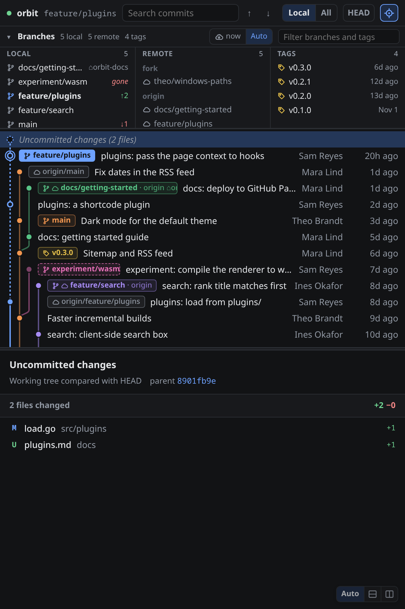

# GGitree

A JetBrains-style git graph for your repository, served as a local web page so it can sit in
[T3 Code](https://github.com/pingdotgg/t3code)'s right panel, or in any browser tab.



## Why

> I was a long-term, happy user of JetBrains IDEs and always liked their git integration and tree a lot.
> Since the AI age, I moved over to many different agent IDEs and CLIs, and now to T3 Code. With all of
> these, I somewhat missed the nice and integrated git tree. I haven't found any existing solution that
> really fits me or my workflow, so I finally decided to create it. … And that's GGitree.
>
> — floholz

The name is short for **go-git-tree**, because there are already too many git-trees.

## Features

- Colored branch lanes with merges, branch and tag labels, and a ring on the checked-out commit
- Commit details with the changed files, and syntax-highlighted diffs
- Uncommitted changes as their own row at the top
- Live: updates within a moment when you or an agent commits, checks out or edits files
- **Follow** keeps the newest change selected (the uncommitted changes, or else HEAD), so you can watch an
  agent work without touching the panel; selecting a commit by hand turns it off
- A branches panel above the graph lists local branches (with ahead/behind counts), remote branches and
  tags; click one to jump to its commit
- Marks branches that are checked out in other worktrees
- Local branches by default; **All** adds every remote branch and tag
- Layout switch: automatic, always stacked, or always side by side
- Follows your light or dark mode
- Read-only: it never changes your repository

One Go binary with the page embedded. No Node at runtime or build time.

## Planned

- Pull request indicators on branches and commits
- GitHub Actions runs and their status for each commit

<br clear="right">

## Install

Requires Go 1.27+ and git.

```sh
make install            # builds, copies ggitree to ~/.local/bin and adds the T3 Code action
make install-service    # optional: also start it at login (systemd user service)
```

`make uninstall` removes all of it again.

## Use

In T3 Code, press `Ctrl+Alt+G` in any thread: the graph of that thread's checkout opens in the right panel.

From a shell:

```sh
ggitree open [path]   # show the repository at path (default: current directory)
ggitree status        # is it running, and what is it showing?
ggitree stop
```

`open` starts the server in the background if needed and points it at the repository; the page is at
<http://127.0.0.1:4747>. Set `GGITREE_ADDR` or pass `--addr` to use another address.

### Keys

| Key | Action |
| --- | --- |
| `↑` `↓` / `j` `k` | Previous / next commit |
| `PgUp` `PgDn` `Home` `End` | Move by page / to the ends |
| `Enter` / `]` | Open the first (next) file's diff |
| `[` | Previous file |
| `Esc` | Back from the diff to the file list |
| `/` or `Ctrl+F` | Search; `Enter` / `Shift+Enter` for next / previous match |
| `H` | Select the checked-out commit |
| `F` | Follow the newest change (the target button next to **HEAD**) |
| `B` | Show or hide the branches panel |
| `Shift+B` | Filter branches and tags (`Enter` jumps to the first match) |

Search matches commit messages, authors, commit ids and branch and tag names.

Clicking a remote branch or tag that the **Local** view doesn't include switches to **All** first. Drag the
line under the branches panel, or between the graph and the details, to resize them. Sizes, the layout, the
Local/All choice and Follow are remembered.

## T3 Code setup

`make install` runs `ggitree t3-install`, which adds a **GGitree** action to every project and binds it to
`Ctrl+Alt+G` (`mod+alt+g`). T3 Code picks the change up without a restart.

- **Where it goes.** T3 Code's settings page only edits one project's actions, so `t3-install` edits
  `~/.t3/userdata/settings.json` directly. It puts the action in the top-level `defaultProjectScripts` list
  that all projects share, and also into each project's own list, because a project with its own list
  ignores the shared one. The shortcut goes in `keybindings.json`.
- **Rerunning.** Running it again only fixes what is missing or out of date, so after a T3 Code update
  changes the format, fix `internal/t3setup` and run `make install` again. A project that gets its own action
  list later needs a rerun too. A shortcut you changed in T3 Code is kept.
- **Backup.** The first run copies both files to `~/.t3/userdata/ggitree-backup/`. Later runs keep that copy.
- **Uninstall.** `make uninstall` (or `ggitree t3-uninstall`) puts the backup back if T3 Code hasn't changed
  the file since the last install. If it has, it removes only GGitree's entries, so your other changes stay,
  and moves the old backup to `ggitree-backup-<date>`.

`--t3-dir` points both commands at another folder (default `$T3CODE_HOME/userdata`, else `~/.t3/userdata`).
The action's fields, if you'd rather add it by hand:

| Field | Value |
| --- | --- |
| Name | `GGitree` |
| Keybinding | `Ctrl+Alt+G` |
| Command | `ggitree open; exit` |
| Preview URL | `http://127.0.0.1:4747` |
| Stop this action when the thread settles | on |
| Open preview automatically when this action runs | on |

How it works:

- The action runs in the thread's own checkout, so the graph shows that worktree.
- `exit` closes the terminal the action ran in. "Stop this action when the thread settles" makes T3 Code
  start a fresh terminal for it rather than reusing one of yours, so `exit` never closes your shell. The
  server detaches from the terminal and keeps running.
- T3 Code opens the preview right after starting the command. If the server isn't running yet, that first
  open can beat it; reload the tab, or run `make install-service` so the server is always up.

## Known limits

- It lives in a browser tab, not a real T3 Code panel. Hiding the right panel while the GGitree tab is active
  turns it into T3's floating preview; close the tab instead, `Ctrl+Alt+G` brings it back. A native panel
  can come once T3 Code supports extensions.
- One server shows one repository at a time. Opening it from another thread switches it to that thread's
  checkout.
- **All** gets very wide on repositories with thousands of remote branches.
- Editing a file that is already listed as changed doesn't refresh its open diff until something else
  changes.

## Develop

```sh
make build        # bundle the page (esbuild via its Go API) and build the binary
make test
make watch        # rebuild the page on change; run `go run . serve .` alongside
make screenshot   # rebuild docs/screenshot.png (needs Node 22+ and Chrome)
```

`make screenshot` builds a made-up repository with `tools/demo/demo-repo.sh` (merged and open branches,
tags, two remotes, a second worktree, uncommitted changes), shows it with a private server and captures the
page with headless Chrome. Set `CHROME` if Chrome isn't on your PATH.

The page lives in `web/src` (plain TypeScript, no framework). `web/tsconfig.json` is only for type checking,
e.g. `npx -p typescript tsc -p web`.

Layout: `internal/gitx` reads git, `internal/graph` assigns lanes, `internal/server` serves the API and
watches the repository, `internal/t3setup` installs the T3 Code action, `web/` is the page.
